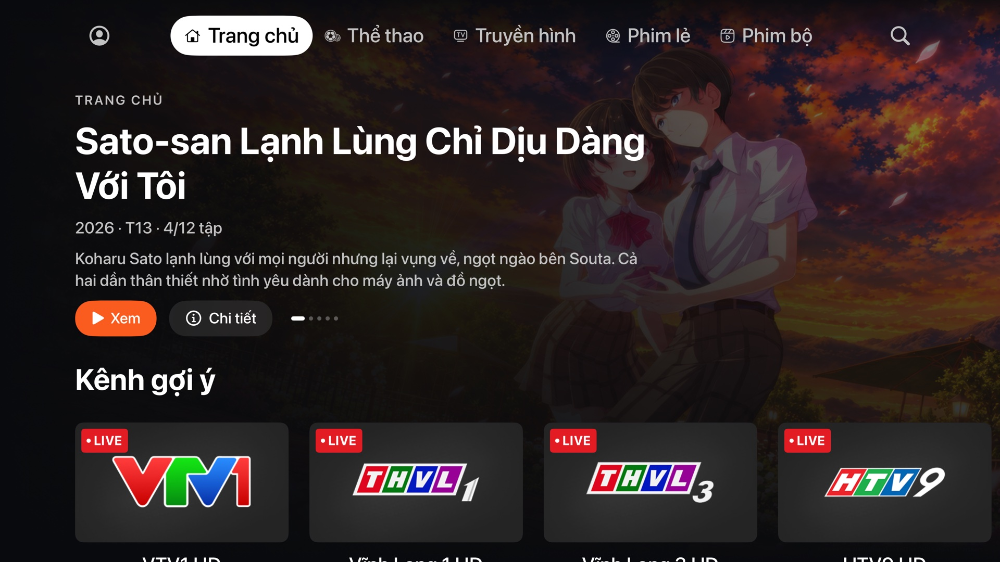

  

<h1 align="center">F3TV</h1>

  Ứng dụng xem FPT Play trên Apple TV, viết bằng SwiftUI cho tvOS. 
  Thể thao, truyền hình trực tiếp, phim lẻ và phim bộ, với giao diện gọn và nhanh.

  <a href="../../releases/latest"><b>Tải bản mới nhất</b></a>

## Tính năng

- **Trang chủ, Thể thao, Truyền hình, Phim lẻ, Phim bộ** với billboard, các hàng nội dung và tìm kiếm.
- **Truyền hình trực tiếp** có nhãn LIVE, chuyển kênh ngay trong trình phát.
- **Phim bộ**: chọn tập trong trình phát, xem tiếp tập sau.
- **Đăng nhập bằng mã QR** (quét bằng app FPT Play trên điện thoại) hoặc bằng số điện thoại.
- **Nhiều hồ sơ**: hỏi "Ai đang xem?", hỗ trợ hồ sơ có passcode.
- **Xem qua không cần đăng nhập**: bấm "Bỏ qua" ở màn chào mừng để duyệt danh mục; chỉ cần đăng nhập khi phát nội dung.
- **Xem tiếp**: phim xem dở hiện ngay đầu Trang chủ và đồng bộ với FPT Play trên điện thoại.
- **Trang chi tiết** có đánh giá, nhãn chất lượng, diễn viên và nội dung liên quan.
- **Thể thao**: lịch thi đấu, kết quả, bảng xếp hạng và đội yêu thích, bố cục theo FPT Play.
- **Trình phát**: bỏ qua intro, tự sang tập sau khi vào credits, chọn chất lượng và âm thanh.
- **Top Shelf**: trận đấu đang diễn ra, phim xem dở và nội dung đề xuất hiện ngay trên màn hình chính của Apple TV.

## Yêu cầu

- Apple TV chạy **tvOS 17** trở lên (Apple TV HD, Apple TV 4K mọi thế hệ).
- Tài khoản **FPT Play** có gói phù hợp để xem nội dung tương ứng.
- Một công cụ sideload cho Apple TV, ví dụ ATVLoadly, và Apple ID để ký app.

## Cài đặt

1. Tải file `F3TV-<phiên bản>.ipa` ở mục [Releases](../../releases/latest).
2. Mở công cụ sideload, chọn Apple TV và file IPA vừa tải, rồi cài đặt. Công cụ sẽ ký lại app bằng Apple ID của bạn.
3. Mở F3TV, chọn **Đăng nhập** và quét mã QR bằng app FPT Play trên điện thoại.

Khi có bản mới, cài đè lên bản cũ; phiên đăng nhập được giữ nguyên.

Lưu ý: tuỳ công cụ sideload, Top Shelf có thể không hiện nội dung nếu công cụ không giữ App Group của app. App vẫn chạy bình thường.

## Lưu ý

F3TV là dự án cá nhân, **không phải ứng dụng chính thức** và không liên kết với FPT Telecom. FPT Play và các nội dung hiển thị trong app thuộc về chủ sở hữu tương ứng. App dùng tài khoản FPT Play của chính bạn và chỉ phát những gì tài khoản đó được phép xem.

Phần mềm được cung cấp nguyên trạng, không kèm bảo hành. Bạn tự chịu trách nhiệm khi cài đặt và sử dụng. Dịch vụ có thể thay đổi bất cứ lúc nào khiến app ngừng hoạt động.
